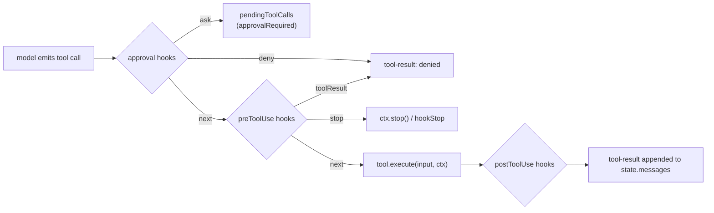

# agentlayer-core

The core agent loop for AgentLayer. Wraps Vercel AI SDK's `streamText` in a resumable,
approval-aware tool-execution loop, and defines the interfaces that platform packages
(`agentlayer-filesystem`, `agentlayer-justbash`) implement. Ships isomorphic tools
(subagent, skill, todo-write, web-fetch, structured-output), prompt fragments, and a
hooks system for intercepting requests and tool calls.

## Install

```bash
bun add @humanlayer/agentlayer-core
```

Subpath exports: `@humanlayer/agentlayer-core/prompts`, `/tools`, `/hooks`, `/utils`, `/interfaces`.

## Usage

```ts
import { Agent, extractLastAssistantText, maxSteps, startState } from '@humanlayer/agentlayer-core'
import { createReadTool, createGlobTool, createGrepTool } from '@humanlayer/agentlayer-filesystem/tools'

const agent = new Agent({
  model: myLanguageModel, // an AI SDK LanguageModel
  tools: {
    read: createReadTool({ cwd: process.cwd() }),
    glob: createGlobTool({ cwd: process.cwd() }),
    grep: createGrepTool({ cwd: process.cwd() }),
  },
  system: ['You review AgentLayer documentation for source changes.'],
  stopWhen: [maxSteps(12)],
})

const result = await agent.run({
  state: startState([{ role: 'user', content: 'Summarize the diff.' }]),
}).result

console.log(extractLastAssistantText(result))
```

`agent.run()` returns an `AgentRun`, an `AsyncIterable<AgentEvent>` you can stream (text
deltas, tool-input deltas, `approvalRequested`, `tokenUsage`, …) while also awaiting
`.result` for the final `RunResult` (`finishReason`, `newMessages`, `tokenUsage`, updated
`state`).

## Key concepts

- **`defineToolInterface` / `defineTool`** (`src/define-tool.ts`) — separates a tool's
  shape (name, description, Zod input/output) from its executor. Interfaces like
  `ReadTool` live in `agentlayer-core`; platform packages call `ReadTool.define(executor)`
  to supply the actual filesystem/sandbox logic. `execute(input, ctx)` receives a
  `ToolContext` with `getContextWindow()`, `updateContextWindow()`, `signal`, `stop()`,
  and (for stateful tools declaring `stateKey`/`stateSchema`) `getToolState()`/`updateToolState()`.
- **`AgentState`** (`src/state.ts`) — serializable resume token: `messages`,
  `pendingToolCalls`, `approvalHistory`, `toolState`, `subAgents`. Build one with
  `startState(messages)`; apply approval/denial decisions with `withApprovals(state, decisions)`.
- **Hooks** (`src/hooks/`, exported via `./hooks`) — four lifecycle points wired into
  `AgentConfig.hooks`: `approval` (`next()`/`deny()`/`ask()` before a tool runs),
  `preToolUse` (mutate input or short-circuit with a cached result), `postToolUse`
  (mutate a tool's output), `preRequest` (transform messages before they hit the model,
  e.g. truncation/deduplication). Built-in hooks include `createApprovalHook`,
  `createPreToolUseHook`, `createPostToolUseHook`, `createPreRequestHook`, plus ready-made
  ones like `deduplicateReads`, `readTruncationHook`, `truncateOldBashResults`,
  `stripThinkingTokens`.
- **Stop conditions** (`src/stop-conditions.ts`) — `maxSteps`, `doomLoop`,
  `consecutiveToolFailures`, `totalToolFailures`, `toolCalled`, `toolCompleted`,
  `structuredOutputCalled`, passed as `AgentConfig.stopWhen`.
- **Interfaces** (`src/interfaces/`, exported via `./interfaces`) — tool shapes only, no
  execution: `ReadTool`, `ReadMultimodalTool`, `WriteTool`, `EditTool`, `MultiEditTool`,
  `ApplyPatchTool`, `BashTool`, `GlobTool`, `GrepTool`, `ListTool`, `CodeSearchTool`,
  `ListCommentsTool`, `CreateCommentTool`, `UpdateCommentTool`, `CreateFileTool`,
  `DeleteFileTool`, `WebFetchTool`, `WebSearchTool`, `SkillTool`.
- **Built-in tools** (`src/tools/`, exported via `./tools`) — fully implemented,
  platform-independent: `createSubagentsTool`, `createSkillTool`, `TodoWriteTool`,
  `createWebFetchTool`, `createStructuredOutputTool`.
- **Prompts** (`src/prompts/`, exported via `./prompts`) — `createAgentSystemPrompt`,
  per-provider system prompt builders (`claudePrompt`, `codexPrompt`, `geminiPrompt`,
  `openaiPrompt`), `environmentPrompt`, `repoInstructionsPrompt`, and tool-description
  text constants (`READ_DESCRIPTION`, `BASH_DESCRIPTION`, etc).

## Tool call lifecycle



`Agent.run()` resumes cleanly from any `RunResult.state`: dangling tool calls from an
interrupted run are re-detected on the next `run()` call and either auto-executed or
re-parked, based on `state.pendingToolCalls`.

## Tests

`bun test` (see `test/`) covers the loop against a mocked AI SDK model
(`test/mocks.ts`), hooks, approvals, sub-agent pausing/resuming, stop conditions, token
usage accounting, and tool interface `.define()` contracts.


## Cleanup feasibility prototype

`AgentRun.stopAndAwaitCleanup({ deadlineMs, expectedGeneration? })` closes resource admission synchronously,
requests cooperative stop and awaits the attached producer and registered resource owners. The first valid
call owns the deadline; concurrent/reentrant calls share one retained operation. A stale expected generation
returns `uncertain` without stopping the current run. Each run has an immutable in-memory `runId`; nested
runs admitted through `cleanupParent` share their root generation while retaining distinct run IDs.

Trusted SDK adapters can reserve ownership before activation with `run.cleanup.startResource(id, start)`.
The synchronous `start` callback returns `{ value, stop, waitForCleanup }`; the latter must attest actual
completion of every writer owned by that adapter. It must return `uncertain` when ownership or completion
cannot be established. Registration after admission closes is rejected before `start` runs. Registration
is reserved before the callback, so a stop racing synchronous activation also awaits the resource.
This is an instrumentation trust contract, **not** OS containment, discovery of escaped descendants,
proof from an empty registry, or authorization to replace a writer.

Configured extension callbacks, custom model providers, dynamic provider-option factories and tool definitions are conservatively marked uninstrumented before the producer starts. Event observers are marked before dispatch and are not newly dispatched after admission closes. Current generic tools are also marked uninstrumented before execution. Model-provider transport
is also uncertain: AI SDK result completion and the current Codex bridge's fiber cancellation do not attest
all client/transport callbacks. Filesystem process execution registers its stop/wait path but permanently
marks descendant ownership uncertain: leader exit, closed stdio or best-effort process-group killing cannot
prove escaped/detached writers stopped. These markers cannot be cleared merely because a run promise
finished. The model/loop receives the internal stop signal, while tools retain the exact caller signal for backward compatibility. Instrumented tools use `ctx.cleanup` stop callbacks; generic tools that ignore that ownership contract remain uncertain. Existing behavior remains when the cleanup API is not invoked.

The finite positive tests use a deliberately instrumented supervisor that acknowledges the actual close of
its exact file-writing grandchild, inside nested SDK runs. Negative tests exercise real escaped writers,
late loopback HTTP/WebSocket callbacks, generic tool completion, deadlines, failures and stale generations.
They do not establish a complete production backend or guarantee arbitrary tools, descendants or remote
effects. The current coding backends can therefore still return `uncertain`; this prototype alone does not
complete HumanLayer automatic progression, installed integration or release provenance.
